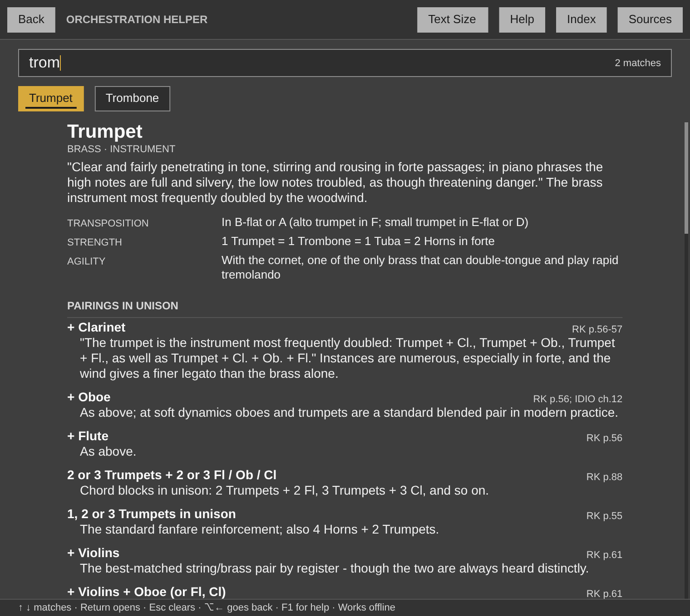

# Orchestration Helper for Ableton Live

A Max for Live MIDI effect. It is `Orchestration Helper.lua` and its two data files, unchanged, running on Middaw's Lua 5.4 runtime, in its own window.

**Its colours are Live's**, after Ableton Live 8's default theme: neutral greys and one amber for what is on, so it sits beside Live's own devices. The REAPER version keeps the house scheme's yellow. The window is the script's own, drawn in those colours: its greys turn neutral at the same brightness, so every contrast it was checked for still holds, and its yellow becomes the amber.

## Installing

Needs **Live 12.1 or later with Max for Live** (Live Suite, or Standard with
the add-on): the device runs on Max 9's JavaScript engine (`[v8ui]`).

1. Copy `Orchestration Helper.amxd`, `OrchestrationHelper.js` and `OrchestrationHelper.maxpat` into one folder, for
   example `Music/Ableton/User Library/Presets/MIDI Effects/Max MIDI Effect/`. The `.amxd` finds
   `OrchestrationHelper.js` beside it.
2. Drag `Orchestration Helper.amxd` onto a MIDI track, in front of an instrument.
3. Optional: open it in the Max editor and click **Freeze Device**, then save.
   The device then carries the script inside it and can be moved on its own.

## Using it

| | |
| --- | --- |
| **Show Window** | Opens the guide. Type an instrument, a section, a composer or a mood; the arrows, Return, Escape and the rest work as in REAPER while the window has focus. |
| The device | It sits on any MIDI track and passes MIDI straight through; it is there to be opened. |

Text Size and the rest of what the script remembers (its ExtState) are kept with the Live set.

## How it is built

`ableton/device.json` describes the device; `python3 ableton/kit/build.py
ableton/device.json` writes the `.amxd`, the `.maxpat` and the script bundle
`OrchestrationHelper.js`. The bundle is Middaw's Lua 5.4 runtime, the script and `orchestration_data.lua` and `orchestration_composers.lua` (read with dofile, as in REAPER), and the shared host (`ableton/kit/lua_device.js`, `gfx.js`). See `ableton/kit/VENDORED.md`.

`node --test ableton/tests/test_device.js` runs the device on a pretend Max and Live: the guide opens with its data, typing finds instruments and Return opens one, a composer and a mood are found, and the Text Size menu works and is kept with the set. `node ableton/window.js` redraws the picture above from the device's own drawing code (it needs Playwright's Chromium).

## Limits

- **It has not been opened in Live yet.** It is tested in Node against a stand-in for Max and the Live Object Model; nothing has run in Max. If the `.amxd` will not open, open `OrchestrationHelper.maxpat` in Max and save it as a device.
- Keys reach the script only while its window has focus, through Max's `[key]`.
- The Mac app on the `mac-app` branch is the same guide outside any DAW.
